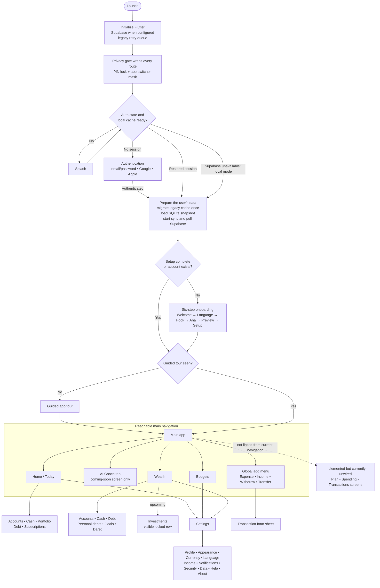
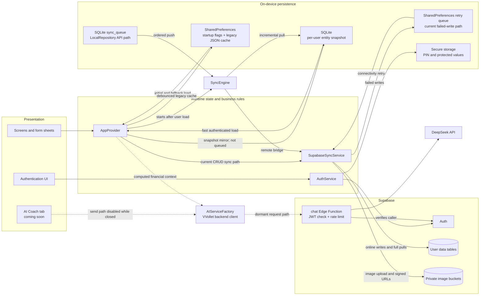

# VVollet app map

Last updated: 2026-11-08

This living product and code map describes the current working tree, including existing uncommitted changes. The initial baseline comes from source inspection, not a full runtime or deployment check. Update it at the end of app tasks following [AGENTS.md](../AGENTS.md).

## App at a glance

VVollet is a Flutter personal finance app for accounts, cash, transactions, budgets, recurring payments, savings goals, debts, investments, and Daret savings groups. It includes an AI Coach, onboarding, localization, and personal settings.

| Layer | Main location | Responsibility |
| --- | --- | --- |
| Entry and navigation | [main.dart](../lib/main.dart) | Startup, authentication/setup routing, privacy gate, four main tabs, global add actions |
| Screens | [screens](../lib/screens) | Feature UI and screen-specific interactions |
| State and financial logic | [app_provider.dart](../lib/providers/app_provider.dart) | Collections, mutations, balances, schedules, persistence coordination |
| Data models | [models](../lib/models) | Accounts, transactions, categories, recurring rules, holdings, goals, Daret, settings |
| Services | [services](../lib/services) | Authentication, sync, secure storage, images, stock prices, AI |
| Shared UI | [widgets](../lib/widgets), [theme](../lib/theme) | Forms, pickers, charts, icons, appearance, reusable components |
| Language and formatting | [l10n](../lib/l10n), [utils](../lib/utils) | Translation catalogs, money display, balance series, recurring dates |
| Checks and helpers | [test](../test), [tool](../tool) | Unit/widget tests, QA entry point, translation generation |

## Navigation and first use

- `main`, `MyApp._buildHome`, `_PrivacyGate`, and `MainScreen` in [main.dart](../lib/main.dart) coordinate service startup, authentication/local-only mode, load flags, onboarding, the tour, privacy overlays, and main navigation.
- [onboarding_flow.dart](../lib/screens/onboarding/onboarding_flow.dart) sequences six onboarding screens. [app_tour_screen.dart](../lib/screens/onboarding/app_tour_screen.dart) handles the tour; [feature_guide_sheet.dart](../lib/screens/onboarding/feature_guide_sheet.dart) provides the automatic first-visit guidance with seen-state saved through the provider. A small persistent question-mark button in each feature header opens the reusable [feature_help_button.dart](../lib/widgets/feature_help_button.dart) sheet, so users can replay a localized explanation of the current screen at any time.
- The main pages are `HomeScreen`, `CoachScreen`, `BudgetsScreen`, and `WealthScreen`. Home is implemented in `today_screen.dart`. `CoachScreen` currently renders only a "coming soon" state: it is closed to every user, its tab stays in the bottom bar, and its feature guide and onboarding tour page are suppressed while closed.
- The privacy gate wraps the app with PIN locking and background masking. Settings are accessible from feature screens.

## Feature map

Implemented code does not by itself establish end-to-end verification or production availability.

Add/edit flows share the transaction-style floating sheet: accounts, categories, savings goals and contributions, debts and payments, personal debts and returns, Daret groups, holdings and sales, recurring-payment editors, and profile name/password changes. The legacy Plan forms and gated Coach rename/project forms use the same presentation in code. Settings preferences and their currency, pay-day, auto-lock, and PIN editors also open as sheets; help/about pages, read-only details, native date/image pickers, confirmations, and the non-dismissible app-lock gate keep their own roles.

| Area | Current responsibility | Main files and dependencies |
| --- | --- | --- |
| Home / Today | Dashboard, balances, account selection, transactions, upcoming subscriptions, financial detail shortcuts. Its balance-evolution card shows a responsive current balance on the left, a right-aligned 1D/1W/1M/6M/1Y selector with a sliding green highlight, and a smooth gold-to-teal trend with localized date labels. Tapping or dragging across the curve persists the selected point, highlights its date below, and shows its exact historical balance in a tooltip. | [today_screen.dart](../lib/screens/today_screen.dart); provider, [balance_series.dart](../lib/utils/balance_series.dart), charts, money formatting |
| Add transaction | The global plus menu exposes expense, income, withdrawal, and transfer. Add/edit forms share a floating rounded sheet that opens at 74% of screen height (capped at 680px), leaving the page visible behind it. The header and close button stay fixed while fields scroll; actions stay at the bottom except on short screens or at large text sizes, where they scroll with the fields. The keyboard opens only when a field is selected, and the sheet fits above it. Close, swipe down, outside tap, and Back dismiss without submitting; only the save action posts the transaction. Recurring bills/subscriptions remain managed through their dedicated flows. | [main.dart](../lib/main.dart), [quick_actions_sheet.dart](../lib/widgets/quick_actions_sheet.dart), [add_transaction_modal.dart](../lib/widgets/add_transaction_modal.dart), [transaction_form_sheet.dart](../lib/widgets/transaction_form_sheet.dart) |
| Accounts | Bank, savings, investment, debt accounts; balances and salary schedules | [accounts_screen.dart](../lib/screens/accounts_screen.dart), [account.dart](../lib/models/account.dart) |
| Cash on hand | Physical cash balance and activity | [cash_on_hand_screen.dart](../lib/screens/cash_on_hand_screen.dart); provider's special cash account ID and transaction-derived `totalCash` |
| Budgets | Category budgets and spending against limits; Add Category uses a flat neutral capsule with its existing 58px height, full width, and category form flow | [budgets_screen.dart](../lib/screens/budgets_screen.dart), [category.dart](../lib/models/category.dart), `getCategorySpending` |
| Subscriptions / bills | Recurring payment management | [all_subscriptions_screen.dart](../lib/screens/all_subscriptions_screen.dart), [recurring_rule.dart](../lib/models/recurring_rule.dart), `processSubscriptions` |
| Wealth | Net worth overview and financial detail entry points. Its Investments breakdown row is visible but locked as an upcoming feature; it does not show an amount or open Portfolio. Portfolio remains implemented and reachable from Home. | [wealth_screen.dart](../lib/screens/wealth_screen.dart); provider aggregate calculations |
| Portfolio | Holdings, purchases/sales, valuation, quote lookup | [portfolio_screen.dart](../lib/screens/portfolio_screen.dart), [holding.dart](../lib/models/holding.dart), [stock_price_service.dart](../lib/services/stock_price_service.dart) |
| Savings goals | Targets, progress, contributions from a funding source | [goals_screen.dart](../lib/screens/goals_screen.dart), [goal.dart](../lib/models/goal.dart), `contributeToGoalFromSource` |
| Debt | Debt tracking, repayments, recurring instalments | [debt_screen.dart](../lib/screens/debt_screen.dart); debt accounts/goals and provider payment methods |
| Personal debts | Personal lending/borrowing records and payment/return flows | [personal_debts_screen.dart](../lib/screens/personal_debts_screen.dart); goals, `recordPersonalDebtReturn`, `receiveDebtPayment` |
| Daret | Rotating savings groups, shares, contributions, payouts | [daret_screen.dart](../lib/screens/daret_screen.dart), [daret.dart](../lib/models/daret.dart); provider Daret methods |
| AI Coach | **Closed to all users behind a "coming soon" screen.** Its existing help button is pinned to the physical top-right inside the safe area, separate from the centered, scrollable message, including in RTL locales. The conversation UI, attachments, tool actions and AI services are intact and still compile, but nothing reaches them. Gated by the `_coachComingSoon` constant in [coach_screen.dart](../lib/screens/coach_screen.dart); set it to `false` to reopen, and the email allowlist in `_hasAccess` applies again. | [coach_screen.dart](../lib/screens/coach_screen.dart), [chat_widgets](../lib/screens/chat_widgets), [AI services](../lib/services/ai) |
| Settings / profile | Appearance, currency, language, income, notification preferences, security, data management, help/about, profile. The hub uses an iOS-inspired large collapsing title, a compact account card that renders the saved profile picture, and flat inset groups with 56px rows, teal icon tiles, plain trailing values, and edge-aligned chevrons in the VVollet palette. Preference destinations open in compact floating sheets with fixed help/close controls and scrollable groups, inheriting the same grouped surfaces and controls. Navigation remains directional in RTL. Profile name/password changes have isolated sheet drafts; preference controls retain their existing immediate-save behavior. | [settings_screen.dart](../lib/screens/settings_screen.dart), [settings](../lib/screens/settings), [settings_ui.dart](../lib/widgets/settings_ui.dart), [account_screen.dart](../lib/screens/account_screen.dart) |

Additional implementations exist in [plan_screen.dart](../lib/screens/plan_screen.dart), [spending_screen.dart](../lib/screens/spending_screen.dart), and [transactions_screen.dart](../lib/screens/transactions_screen.dart). At baseline, searching `lib` found their constructors only in their own declarations: treat them as currently unwired screens, not main navigation destinations. Plan contains fixed, variable, and sinking-fund UI.

## Data and financial rules

| Model | What it stores |
| --- | --- |
| [Account](../lib/models/account.dart) | Identity/type/balance, net-worth inclusion, salary scheduling, debt payment settings |
| [Transaction](../lib/models/transaction.dart) | Type, amount, fees, date, source/destination account, category, recurrence, attachment, expense subtype |
| [Category](../lib/models/category.dart) | Fixed/variable grouping, appearance, monthly budget limit |
| [RecurringRule](../lib/models/recurring_rule.dart) | Transaction template, frequency, next date, active flag |
| [Holding](../lib/models/holding.dart) | Symbol, shares, cost/current price, purchase and funding-source information |
| [Goal](../lib/models/goal.dart) | Goal/debt type, target/current amounts, priority, optional payment schedule |
| [Daret](../lib/models/daret.dart) | Shares, contribution amount, payout months, start date, progress calculations |
| [Settings](../lib/models/settings.dart) | Income, currency/format, locale, appearance, privacy and other preferences |

[AppProvider](../lib/providers/app_provider.dart) is the central change point for financial behavior:

- Transaction add/update/delete adjusts affected balances. Changes must consider reversal of the previous transaction, fees, transfers, physical cash, and linked goals/debts.
- Cash on hand is derived from transaction types, not a normal stored bank balance.
- `getSafeToSpendMonth` subtracts this calendar month's expense, goal contribution, debt payment, personal debt return, and Daret contribution totals (including fees) from configured monthly income. `getSafeToSpendToday` divides by calendar days remaining, including today. These methods do not themselves reserve future unpaid bills.
- `getNetWorth` combines included non-investment account balances, cash, and investment value; subtracts remaining `debt` goals and adds remaining `personal_debt` goals. Consult the method before changing debt sign conventions.
- Salary schedules belong to accounts. `processSalaries`, account date helpers, and `setAccountSalary` coordinate posting and income configuration.
- `processSubscriptions` handles due recurring transactions. [recurring_dates.dart](../lib/utils/recurring_dates.dart) handles schedule calculations, including short-month boundaries.
- Goal/debt contributions, investment purchases/sales, and Daret payments can affect both feature records and funding balances. Keep these paths aligned with transaction editing/deletion.
- Selected account state is shared across screens. Aggregate values are cached and invalidated through provider changes.

## Persistence and integrations

- [auth_service.dart](../lib/services/auth_service.dart) owns authentication state and restores Supabase sessions. When Supabase is unavailable it deliberately enters authenticated local-only mode as `local_user`; cloud sign-in methods are unavailable in that mode. [supabase_config.dart](../lib/services/supabase_config.dart) initializes the client. Signed-in users can reach **Settings → Account → Delete account**. The UI confirms first, calls the authenticated `delete-account` Edge Function, then captures the pre-sign-out user ID to clear that user's SharedPreferences and SQLite cache. Local-only mode does not expose the cloud-account deletion control.
- [app_provider.dart](../lib/providers/app_provider.dart) is currently in a **transitional dual-persistence state**. It first loads the legacy SharedPreferences cache, then for an authenticated user initializes SQLite, imports the legacy cache once, serves a SQLite snapshot when present, starts `SyncEngine`, and performs a full Supabase pull. Normal provider mutations still write the SharedPreferences cache, mirror a non-dirty snapshot into SQLite, and call the public `SupabaseSyncService` methods directly.
- [supabase_sync_service.dart](../lib/services/supabase_sync_service.dart) is therefore still the active app-wide mutation sync path. Failed operations are stored in its SharedPreferences-backed retry queue and flushed on connectivity changes. The newer [local_repository.dart](../lib/data/local_repository.dart), [sync_queue.dart](../lib/data/sync_queue.dart), and [sync_engine.dart](../lib/data/sync_engine.dart) implement atomic SQLite writes plus a durable ordered queue, but current `AppProvider` CRUD methods do not yet call those repository write APIs. Treat that path as partially integrated rather than the sole production path.
- Daret records are local-only in the current implementation: `SyncEngine` explicitly completes Daret queue work without a remote write because no Supabase Daret table/endpoint exists.
- [secure_storage_service.dart](../lib/services/secure_storage_service.dart) and [app_lock_service.dart](../lib/services/app_lock_service.dart) support protected storage and the app PIN. [image_service.dart](../lib/services/image_service.dart) handles image operations.
- **User images (profile pictures, receipts, account logos) persist across reinstall once their upload reaches Supabase.** Uploads go to private Supabase Storage buckets (`avatars`, `receipts`, `logos`) under a per-user folder with a server-chosen name, and the database row stores the **object path**, never a URL. Buckets are private, so links must be signed and expire within the hour; persisting one would break the image shortly after upload and permanently after a reinstall. `SupabaseSyncService.resolveImageUrl` signs a path on demand and caches the result, and [stored_image.dart](../lib/widgets/stored_image.dart) accepts an object path, a local file path, or a legacy full URL. A selected profile image is first copied from the temporary image-picker cache into app-owned storage and shown immediately. A failed/offline cloud upload is deduplicated in the persisted retry queue; server refreshes preserve that pending local picture, and later retry stores `{user_id}/avatar.jpg` in `profiles.avatar_url`. Removing the picture cancels its pending upload, clears the cloud reference, and deletes the local copy. Both [supabase_complete_setup.sql](../supabase_complete_setup.sql) and [20260919000000_profile_avatars.sql](../supabase_migrations/20260919000000_profile_avatars.sql) create the private avatar bucket and owner policies.
- [stock_price_service.dart](../lib/services/stock_price_service.dart) calls Yahoo Finance chart/search endpoints. Live availability was not checked in this task.
- [env_config.dart](../lib/services/env_config.dart) and [ai_config.dart](../lib/services/ai/ai_config.dart) define build configuration. Keep secret values out of documentation.
- [ai_service_factory.dart](../lib/services/ai/ai_service_factory.dart) binds the AI adapter. Only the VVollet backend adapter remains: it calls a configured backend with the user's Supabase session token and holds no credential of its own. A direct-to-Gemini adapter was removed in the 2026-09 security work because it required an API key compiled into the app binary, where it is extractable.
- [financial_context_service.dart](../lib/services/ai/financial_context_service.dart) builds Coach's financial snapshot. [AI tools](../lib/services/ai/tools) define actions and execution; [ai_confirmation_card.dart](../lib/widgets/ai_confirmation_card.dart) presents confirmations. In the executor, reads execute directly and writes require confirmation.
- [voice](../lib/services/ai/voice) contains session/transport abstractions. `VoiceTransport` explicitly has no concrete implementation yet; realtime voice is not established as shipped.
- [supabase/functions/chat](../supabase/functions/chat) is the DeepSeek Edge Function the app now targets by default: `AIConfig.baseUrl` falls back to the configured Supabase project's `/functions` host, so the client resolves to `/functions/v1/chat`. The function verifies the caller's Supabase JWT, validates the payload, caps body size and rate-limits per user. Whether it is actually deployed was not verified from the repository.

## Shared UI and localization

- [app_theme.dart](../lib/theme/app_theme.dart), colors, text styles, transitions, and icon files define shared appearance. Settings select light/dark/system theme and text scaling.
- [app_text_styles.dart](../lib/theme/app_text_styles.dart) is the app-wide semantic typography contract. Inter is bundled under [assets/fonts](../assets/fonts) so it does not depend on a runtime font download. Screen titles use 24/700, section titles 18/600, item titles 15/600, descriptions 13/400, and labels 12/600; light and dark themes apply these roles to app bars, dialogs, list tiles, buttons, settings rows, and shared controls. Money and statistics use tabular figures and retain their responsive sizing rules for large values.
- [settings_ui.dart](../lib/widgets/settings_ui.dart) supplies the complete settings visual language: subtle ambient light/dark backgrounds, large collapsing page headers, flat inset panels, localized group labels, teal icon tiles, plain trailing values, press feedback, adaptive switches, animated choice indicators and segmented controls, sliders, text fields, confirmations, and the PIN backdrop. Tappable rows keep long values bounded and ellipsized while the plain chevron stays aligned to the outer edge. Directional arrows and placement adapt to RTL locales.
- [app_form_sheet.dart](../lib/widgets/app_form_sheet.dart), [app_picker_field.dart](../lib/widgets/app_picker_field.dart), and [account_picker_field.dart](../lib/widgets/account_picker_field.dart) are shared form building blocks. [feature_help_button.dart](../lib/widgets/feature_help_button.dart) supplies the compact question-mark control and localized explanatory bottom sheet used by the main tabs, finance detail headers, profile/plan pages, and every settings destination. Wealth, settings, and onboarding also have shared UI helpers.
- [app_form_sheet.dart](../lib/widgets/app_form_sheet.dart) owns the common `showAppFormSheet` route and floating form layout: 74% of the viewport, capped at 680px high/560px wide, 10px side gaps, 340ms opening/240ms closing, system reduced-motion support, rounded translucent surface, and animated keyboard clearance. Headers and localized 44px close controls remain visible while fields scroll. Save actions stay at the bottom; below 400px available height or above 1.4 text scale they scroll with the fields. Close, outside tap, swipe and Back dismiss draft-based forms without submitting. Settings with immediate-save controls retain that behavior. Fields wait for a tap before showing the keyboard.
- [transaction_form_sheet.dart](../lib/widgets/transaction_form_sheet.dart) now delegates to `AppFormSheet`, retaining the transaction header and test keys; `showTransactionSheet` in [add_transaction_modal.dart](../lib/widgets/add_transaction_modal.dart) delegates to the common route. `AppFormSheetScope` lets `SettingsScaffold` render preferences inside the same surface, while full-page callers keep their existing layout. Nested pickers return to the editor underneath. Settings PIN creation/verification uses the sheet; the app-lock gate remains full-screen and non-dismissible.
- Financial form field logic, validation, and provider mutation calls are preserved by the presentation migration. Long gallery-upload labels and the savings auto-save label wrap within the narrower form. Shared save buttons explicitly use the app typography. Profile sheets own/dispose their text controllers and show service errors without closing the draft.
- [transaction_delete_button.dart](../lib/widgets/transaction_delete_button.dart) supplies a fixed 48px red-tinted trash button beside Edit in Home and Transactions detail sheets. Its localized tooltip provides the accessible label without a wrapping text caption; each caller retains its existing delete confirmation and cancellation flow.
- [glass_action_button.dart](../lib/widgets/glass_action_button.dart) supplies Budgets' Add Category capsule: flat neutral light/dark fill, subtle border, and matching theme-colored icon and label. Its existing 58px height, full width, pill shape, press animation, haptic response, and form-opening callback are retained.
- [balance_chart.dart](../lib/widgets/balance_chart.dart), [modern_chart.dart](../lib/widgets/modern_chart.dart), and [balance_series.dart](../lib/utils/balance_series.dart) cover charts. [money_format.dart](../lib/utils/money_format.dart) centralizes money display; its compact mode runs to trillions and carries a rounded value into the unit above, so a figure never renders as `1000K`.
- `MoneyAmount` in [money_amount.dart](../lib/widgets/money_amount.dart) is the single shared money figure. It takes a value and a [MoneyFormat](../lib/utils/money_format.dart) and measures at the active text scale. Concessions run cheapest first: shrink the type toward `minFontSize`, then below it to a 13px legibility floor, and only abbreviate to "2.5M" when no legible size fits. `minFontSize` is a preference, not a hard limit. Abbreviation is additionally gated on the figure having at least six integer digits, so a short value never loses digits to save a few glyphs. `allowCompact: false` forbids it outright. `currencyInline` places the selected currency directly after both exact and compact figures; otherwise it uses a caption line. Long press reveals the exact figure; hidden balances stay masked in the tooltip and in semantics. Home Total Balance, Home Balance, Wealth Net Worth, breakdown rows, and `WealthOverviewCard` all use inline currency.
- Vertical space on the Wealth card is a design constraint: the net-worth card and the first breakdown rows must stay above the fold on a 390x844 phone. Large numbers are absorbed by responsive type size and by dropping cents, without adding a separate currency line.
- [money_format.dart](../lib/utils/money_format.dart) drops the fractional part at or above 100,000 whatever the decimals preference says, since nobody reads the cents on a seven-figure balance and those glyphs are what force a hero to shrink.
- [app_localizations.dart](../lib/l10n/app_localizations.dart) exposes `S` and 16 locale codes: en, fr, ar, es, de, pt, it, tr, nl, ru, zh, ja, ko, hi, id, pl. Catalogs are split by feature/settings/onboarding/core. [tool](../tool) contains feature translation generators and a manifest.
- Branding assets are in [assets/icons](../assets/icons), with launcher resources in [Android](../android/app/src/main/res) and [iOS](../ios/Runner/Assets.xcassets/AppIcon.appiconset). Other native project folders do not by themselves establish tested platform support.

## Validation map

These are existing checks, not a record that they passed during the baseline task.

| Change area | Existing checks |
| --- | --- |
| Financial mutations, goals/debt/Daret, recurrence | [core_feature_logic_test.dart](../test/core_feature_logic_test.dart) |
| Salary scheduling/editing | [salary_cycle_test.dart](../test/salary_cycle_test.dart), [salary_editing_test.dart](../test/salary_editing_test.dart) |
| Chart calculations and money display | [balance_series_test.dart](../test/balance_series_test.dart), [home_balance_card_test.dart](../test/home_balance_card_test.dart), [money_format_test.dart](../test/money_format_test.dart) |
| Add flows and shared forms | [plus_actions_test.dart](../test/plus_actions_test.dart), [transaction_sheet_test.dart](../test/transaction_sheet_test.dart), [app_form_sheet_test.dart](../test/app_form_sheet_test.dart), [feature_form_sheets_test.dart](../test/feature_form_sheets_test.dart), [app_picker_field_test.dart](../test/app_picker_field_test.dart) |
| Feature screens and wealth UI | [feature_screens_smoke_test.dart](../test/feature_screens_smoke_test.dart), [wealth_ui_test.dart](../test/wealth_ui_test.dart) |
| Settings, confirmations, sign-out | [settings_screens_test.dart](../test/settings_screens_test.dart), [settings_confirm_test.dart](../test/settings_confirm_test.dart), [sign_out_routing_test.dart](../test/sign_out_routing_test.dart) |
| Typography, bundled font, and hierarchy | [typography_system_test.dart](../test/typography_system_test.dart), [settings_screens_test.dart](../test/settings_screens_test.dart) |
| Onboarding and translations | [onboarding_screens_test.dart](../test/onboarding_screens_test.dart), [onboarding_translations_test.dart](../test/onboarding_translations_test.dart), [localization_catalog_test.dart](../test/localization_catalog_test.dart) |
| Reopenable contextual screen help | [feature_help_button_test.dart](../test/feature_help_button_test.dart), feature and settings screen matrices |
| AI read/write tools | [ai_tool_executor_test.dart](../test/ai_tool_executor_test.dart) |

Typical commands: `flutter analyze`, `flutter test`, or `flutter test test/<relevant_test>.dart`. [qa_main.dart](../tool/qa_main.dart) is an additional QA entry point; inspect its setup before use.

## Known boundaries

- The baseline checked source structure and selected behavior; it did not run the app, Flutter tests, authentication, cloud sync, stock requests, or AI requests.
- Notifications are local-only: expense reminders and upcoming-payment reminders are one-shot, inexact Android alarms, restored by the plugin after reboot. Budget threshold alerts are evaluated from on-device categories and transactions. Notification delivery is off by default, asks Android permission only when enabled, and does not use Firebase/FCM or upload device tokens. Physical-device delivery, reboot restoration, and OEM battery behaviour are not yet verified.
- Three additional screens are currently unwired, voice transport is scaffolding, and deployment status is unknown, as detailed above.
- The user reported applying [20260919000000_profile_avatars.sql](../supabase_migrations/20260919000000_profile_avatars.sql) to the live Supabase project on 2026-09-20. Independent authenticated upload/download verification has not run: the workspace has no Supabase management or user access token, and the anonymous bucket-metadata endpoint returns the same HTTP 400 `Bucket not found` response for all three private buckets (`receipts`, `logos`, and `avatars`), so it cannot confirm private-bucket existence.
- Add newly discovered gaps here with evidence; revise or remove them when a task resolves or verifies them.

## Completed task history

Append one concise entry per relevant completed task. Keep the sections above current as well.

| Date | Outcome | Affected areas/files | Validation and limitations |
| --- | --- | --- | --- |
| 2026-09-11 | Created the living app map and persistent maintenance instructions; refreshed the outdated README overview. | `docs/APP_MAP.md`, `AGENTS.md`, `README.md` | Inspected source, navigation references, models, services, and test inventory. Checked documentation file links. Documentation-only change; no Flutter tests or live services run. |
| 2026-09-11 | Made large amounts on the Wealth screen fit their layout: added the shared `WealthAmount` figure, applied it to the net-worth hero, the three gold stat columns and the breakdown rows, reused it for the Home hero and the wealth overview card, routed the hand-built `+`/`-` stats through `MoneyFormat.signed`, and extended compact formatting to trillions with a rounding carry. | `lib/widgets/wealth_ui.dart`, `lib/screens/wealth_screen.dart`, `lib/screens/today_screen.dart`, `lib/utils/money_format.dart`, `test/wealth_ui_test.dart`, `test/money_format_test.dart` | `flutter test` on the money-format, wealth-UI and balance-series suites: 67 passed, 0 failed. `flutter analyze` on the four touched files: 48 issues, all matching the pre-change baseline (`withOpacity` deprecations and unused locals); none in the new code. Full `feature_screens_smoke_test.dart`: 767 passed, 1 failed — the pre-existing `de`-locale portfolio overflow noted under Known boundaries, reproduced with these changes stashed. Not run: the app itself, cloud sync, or a device at a real text scale. |
| 2026-09-13 | Finished the large-number work on Wealth after a partial pass left two rival widgets. Consolidated on `MoneyAmount`, deleted the duplicate `WealthAmount`, and reordered its concessions so abbreviating is a true last resort: the hero rendered a -2,498,865.00 net worth as "-2.5M" despite room to show it in full. Restructured the gold stat rows from label-beside-figure to label-above-figure, since the side-by-side split left the amount ~135px of a 241px card and forced the same abbreviation directly under an exact hero. Moved `WealthOverviewCard`'s hero to `amountValue` + `formatter`, updated its four detail-screen callers, moved the Home hero across, and fixed the `signed` flag so negatives keep one minus. | `lib/widgets/money_amount.dart`, `lib/widgets/wealth_ui.dart`, `lib/screens/wealth_screen.dart`, `lib/screens/today_screen.dart`, `lib/screens/{daret,debt,goals,personal_debts}_screen.dart`, `test/wealth_ui_test.dart` | `flutter test` on the wealth-UI, money-format and feature-screens suites: 811 passed, 0 failed, including the `de`-locale portfolio case that previously overflowed. `flutter analyze` on the eight touched files: 77 issues, all pre-existing (`withOpacity` deprecations, unused locals and lints in untouched regions); none in the new code. Rendering confirmed in widget tests at the reported screenshot's geometry and data: hero and all three stat rows show full digits. Not run: the app on a device, or a rebuilt APK. |
| 2026-09-13 | Cut the Wealth card back down after the number work made it too tall to see the Breakdown without scrolling. Restored the three-across stat row, moved breakdown amounts back beside their labels, made the currency caption opt-in so only the hero pays for it, and dropped cents at or above 100,000. Gated abbreviation on six integer digits after it shortened "+1,000.00" to "+1K". | `lib/widgets/money_amount.dart`, `lib/screens/wealth_screen.dart`, `lib/utils/money_format.dart` | `flutter test` on the wealth-UI, money-format and feature-screens suites: 811 passed, 0 failed. `flutter analyze` on the touched files: no new issues. Layout measured in a widget test at 390x844: hero occupies 186-251, Breakdown starts at 407, and the Accounts, Cash on Hand and Investments rows all sit above the fold. Not run: the app on a device, or a rebuilt APK. |
| 2026-09-15 | Redesigned the Home balance-evolution card from the supplied dashboard reference: moved the localized Balance label and responsive amount to the left, grouped 1D/1W/1M/6M/1Y on the right with accessible selected states, and replaced the busy plot with an animated smooth gold-to-teal curve, localized dates, and exact-value touch tooltips. The curve prevents spline overshoot so it cannot imply balances outside the calculated series. Built the requested Android release APK; the later Home-chart refinement below superseded that APK. | `lib/screens/today_screen.dart`, `test/home_balance_card_test.dart`, `build/app/outputs/flutter-apk/app-release.apk` | Focused card test: 1 passed. Home smoke matrix at 390x844 across all 16 locales and both themes: 32 passed. Full `flutter test`: 1,848 passed, 0 failed. Targeted analysis compiled successfully and reported 39 existing warnings/info in `today_screen.dart`, with no errors. `flutter build apk --release` succeeded. Android release currently uses the debug signing config, so this artifact is suitable for direct installation/testing and needs a production keystore before store distribution. No physical Android-device run was available. |
| 2026-09-15 | Closed the AI Coach for all users behind a "coming soon" screen, as requested. Gated on a single `_coachComingSoon` constant rather than deleting anything, so the services, tools, conversation store and sync paths stay intact and reopening is a one-line change. The screen now renders a centred sparkle, the existing `aiCoachComingSoon` heading and the feature name, with no drawer, no history and no chat input, and `_hasAccess` returns false so no send path can run. Skipped the conversation load entirely while closed, and suppressed both the coach feature-guide sheet on tab open and the coach page in the onboarding tour, since neither should advertise a closed tab. Reused two already-translated strings so no locale shows a raw key. | `lib/screens/coach_screen.dart`, `lib/main.dart`, `lib/screens/onboarding/app_tour_screen.dart`, `test/coach_closed_test.dart`, `docs/APP_MAP.md` | `flutter test` on the feature-screens, onboarding, plus-actions, wealth-UI and money-format suites: 1,143 passed, 0 failed. `flutter analyze` on the three touched files: 30 issues, all pre-existing (deprecated `withOpacity`, and dead `_addProject`/`_fmtDate` declarations that predate this change). Caught and fixed a real bug during verification: the coming-soon branch initially sat behind the `_ready` loading guard, so the screen showed an endless spinner whenever the Supabase and secure-storage load did not complete, such as offline or on a cold start. The new `coach_closed_test.dart` covers that case, which the smoke suite cannot because it only asserts no exception and a blank screen satisfies that. Not run: the app on a device, or a rebuilt APK. |
| 2026-09-15 | Refined the Home dashboard: anchored Upcoming Subscriptions and See All to opposite sides with an RTL-aware row; replaced independent range-button fills with one green highlight that slides between 1D/1W/1M/6M/1Y; and made line selection persistent. A selected history point now has a visible dot, an uncluttered highlighted localized date beneath the curve, and an exact balance/date tooltip derived from `buildBalanceSeries` transaction history. Rebuilt the APK. | `lib/screens/today_screen.dart`, `test/home_balance_card_test.dart`, `build/app/outputs/flutter-apk/app-release.apk` | Focused balance-card and balance-series tests: 32 passed, 0 failed. Home smoke matrix at 390x844 across all 16 locales and both themes: 32 passed, 0 failed. Targeted analysis found no compile errors; 40 existing warnings/info remain in `today_screen.dart`. Release APK build passed; 65.22 MB, SHA-256 `CDC3FCF17D996F0F530D85D8A69CCCE687AF6234868ADCA857E1269D4E44EDF1`. No physical Android-device run was available. |
| 2026-09-15 | Unified the app typography around a complete semantic hierarchy: bundled Inter for reliable offline loading; standardized screen, section, item, description, and label roles; wired those roles into both themes and shared settings controls; normalized stray fractional sizes in feature, onboarding, and Coach UI; and kept responsive money sizing and full large values. Rebuilt the Android release APK with the bundled font. | `assets/fonts`, `pubspec.yaml`, `lib/theme/app_text_styles.dart`, `lib/theme/app_theme.dart`, `lib/theme/app_fonts.dart`, `lib/widgets/settings_ui.dart`, settings screens, onboarding/shared UI, Coach/chat widgets, `test/typography_system_test.dart`, `build/app/outputs/flutter-apk/app-release.apk` | Focused typography and settings matrix: 388 passed, 0 failed. Full `flutter test`: 1,852 passed, 0 failed. Targeted analysis found no compile errors and reported 79 existing warnings/info, primarily deprecated `withOpacity` calls and unused Coach code. `git diff --check` passed. Release APK build passed; 65.61 MiB, SHA-256 `D108ED4F1684F1C9917A0B48B57828FBF695CA5E3432D81566B9BB7C165EA452`. No physical Android-device run was available. |
| 2026-09-15 | Redesigned the complete Settings experience. The hub and all subsections now share a restrained gradient backdrop, refined glass cards, consistent accent icon tiles and value pills, clearer group headings, animated selected states, improved sliders and switches, tactile row feedback, and directional navigation for RTL. The profile card and PIN screen received matching visual treatments, while labels that had been forced to uppercase now preserve their localized casing. Rebuilt the Android release APK. | `lib/widgets/settings_ui.dart`, `lib/screens/settings_screen.dart`, `lib/screens/settings/pin_entry_screen.dart`, `lib/screens/settings/currency_format_screen.dart`, `lib/screens/settings/currency_picker_screen.dart`, `lib/screens/settings/data_storage_screen.dart`, `docs/APP_MAP.md`, `build/app/outputs/flutter-apk/app-release.apk` | Rendered and visually inspected the Settings hub in dark mode and Appearance subsection in light mode at 390x844. Settings, confirmation, and typography suites: 397 passed, 0 failed, covering every settings screen in all 16 locales and both themes. Targeted analysis: no issues. `git diff --check` passed. Release APK build passed; 65.63 MiB, SHA-256 `EEF106411789FC72CBC1694E5190AF91916C8ABB1AD2BE7A156B5F0421253502`. No physical Android-device run was available. |
| 2026-09-15 | Fixed Settings destination alignment from the supplied French screenshot: replaced the loose flexible current-value area with a width-bounded trailing cluster, keeping every navigation button on the outer right edge in LTR and the green information pill immediately beside it. Long values now truncate inside the pill without moving the arrow. Rebuilt the Android release APK. | `lib/widgets/settings_ui.dart`, `test/settings_screens_test.dart`, `docs/APP_MAP.md`, `build/app/outputs/flutter-apk/app-release.apk` | Added a regression case comparing rows with short and long values. Settings, confirmation, and typography suites: 398 passed, 0 failed, including every settings screen in all 16 locales and both themes. Targeted analysis: no issues. Release APK build passed; 65.63 MiB, SHA-256 `A4E90DF67F4C3DD32A2484D1A2C670C61AC6FEEFD8EA07DC7570F8ECB5BF8A0E`. No physical Android-device run was available. |
| 2026-09-15 | Moved the selected currency beside the figure for Home Total Balance, Home Balance, Wealth Net Worth, and wealth overview amounts. Replaced the shared money widget's ambiguous currency flag with explicit inline placement and preserved the currency when extreme values fall back to compact notation. Rebuilt the Android release APK. | `lib/widgets/money_amount.dart`, `lib/screens/today_screen.dart`, `lib/screens/wealth_screen.dart`, `lib/widgets/wealth_ui.dart`, `test/money_amount_test.dart`, `test/home_balance_card_test.dart`, `test/wealth_ui_test.dart`, `docs/APP_MAP.md`, `build/app/outputs/flutter-apk/app-release.apk` | Focused money, chart, and wealth suites: 114 passed, 0 failed. Home and Wealth smoke matrices: 96 passed, 0 failed across all 16 locales, both themes, and populated data. Targeted analysis compiled successfully and reported 50 existing warnings/info in the two large screens; no issues in the shared money widget. Release APK build passed; 65.63 MiB, SHA-256 `22104981DF9DA14CBC9DFA1EA74F0B11CB1EADA9D6320AEF9376AF684BB19EBB`. No physical Android-device run was available. |
| 2026-09-16 | Removed the confusing standalone Add Bill action from the global plus menu, along with its callback and dedicated modal implementation. The plus menu now contains only Expense, Income, Withdraw, and Transfer. Dedicated recurring bill/subscription management remains available. Rebuilt the Android release APK. | `lib/main.dart`, `lib/widgets/quick_actions_sheet.dart`, `test/plus_actions_test.dart`, `docs/APP_MAP.md`, `build/app/outputs/flutter-apk/app-release.apk` | Quick-action, financial-logic, and full feature-screen suites: 846 passed, 0 failed, including subscription screens, all 16 locales, both themes, and populated data. Targeted analysis compiled successfully and reported four existing lint/deprecation notices in `main.dart`; no errors. Release APK build passed; 65.55 MiB, SHA-256 `7973FDFC793479F21A4827B323AB02F33A73D556BA6A236838526C7B0AFF5055`. No physical Android-device run was available. |
| 2026-09-16 | Added a persistent, compact question-mark help button to feature screens so users can reopen guidance after the first-use tour. The localized glass bottom sheet explains the current screen and uses the screen's translated title and description. Coverage includes Home, Coach, Budgets, Wealth, accounts, cash, portfolio, debts, personal debts, goals, Daret, subscriptions, spending, transactions, the legacy plan, profile, and every shared Settings page. Rebuilt the Android release APK. | `lib/widgets/feature_help_button.dart`, `lib/widgets/wealth_ui.dart`, `lib/widgets/settings_ui.dart`, feature screen headers, `test/feature_help_button_test.dart`, `docs/APP_MAP.md`, `build/app/outputs/flutter-apk/app-release.apk` | Help interaction plus feature, settings, and wealth UI suites: 1,171 passed, 0 failed, covering all 16 locales, both themes, RTL, and populated data. Targeted analysis compiled successfully; it reported only pre-existing warnings/info in the large legacy screens. Release APK build passed; 63.75 MiB, SHA-256 `656B7069386A486EF2E9EDB4F313B7C25DE8CB3FC89E7A991ADDC43A082B4D68`. No physical Android-device run was available. |
| 2026-09-16 | Refined transaction presentation while preserving the existing app design: add/edit forms open in a floating sheet at 74% height with smooth entry/exit, a pinned close control, scrolling fields, and keyboard-aware sizing. The keyboard waits for a field tap. Close, swipe, outside tap, and Back cancel without posting; primary actions remain reachable on short screens and at large text scales. | `lib/widgets/transaction_form_sheet.dart`, `lib/widgets/add_transaction_modal.dart`, `lib/main.dart`, Home/Transactions edit launchers, `test/transaction_sheet_test.dart`, `docs/APP_MAP.md` | 98 focused tests passed: all four transaction types, validation across 16 locales, route interactions in en/fr/ar and both themes, cancel/reopen without writes, saving once, keyboard clearance, small/landscape viewports, large text, and reduced motion. Targeted analysis of the form, sheet and new test: no issues. Inspected rendered dark and light French sheets using the bundled font; RTL geometry checked in widget tests (headless Arabic font fallback limits visual text inspection). Diff whitespace and map-link checks passed. Release APK rebuilt successfully: 63.89 MiB, SHA-256 `E8C3777A8BEDC08A4B4D9501EFF3083B2EF87A50EAA32E5DC82537FC28621A69`. No physical-device run. |
| 2026-09-19 | Replaced the wrapping Delete caption in Home and Transactions detail sheets with a compact red-tinted trash action and localized tooltip. Simplified Budgets Add Category to a flat neutral fill with matching icon/text, preserving its exact dimensions and callback. | `lib/widgets/transaction_delete_button.dart`, `lib/widgets/glass_action_button.dart`, `lib/screens/today_screen.dart`, `lib/screens/transactions_screen.dart`, `lib/screens/budgets_screen.dart`, `docs/APP_MAP.md` | 144 existing Home, Transactions, and Budgets smoke tests passed across all 16 locales, both themes, and populated data. Targeted analysis: no errors; 70 existing screen warnings/info, none in the two button widgets. Diff whitespace check passed. Release APK built successfully (63.91 MiB; SHA-256 `5D34C0D74D8D294491C6E0E37C0ECC3F5CB5C0CDAF45A27CDBD2C48F3D49DFE5`). The first build exhausted Java native memory; retry passed with a process-only 2 GiB Gradle heap and two workers. No physical-device visual or interaction run. |
| 2026-09-19 | Added user profile pictures and made every stored image survive a reinstall. Uploads now return the storage **object path** instead of a URL, and rows persist that path: the buckets are private, so a signed URL expires within the hour and a persisted one left receipts broken shortly after upload and permanently after reinstalling. Added the `avatars` bucket with owner-scoped policies for all four verbs, `profiles.avatar_url`, a `Settings.avatarPath` field carried back by `withRemoteProfile`, and provider methods that upload, replace and delete a picture. Introduced the shared `StoredImage` widget and moved all twelve display sites onto it, so an object path, a local file path, or a legacy URL all render correctly. Signed URLs are cached below their expiry so scrolling does not re-sign per frame. | `supabase_migrations/20260919000000_profile_avatars.sql`, `lib/widgets/stored_image.dart`, `lib/services/supabase_sync_service.dart`, `lib/models/settings.dart`, `lib/providers/app_provider.dart`, `lib/screens/account_screen.dart`, six screens and two widgets with image display, `lib/l10n/translations_{core,extra}.dart`, `test/image_persistence_test.dart`, `docs/APP_MAP.md` | `flutter test` across the suite excluding one file: 1,938 passed, 1 failed — a pre-existing balance-card overflow reproduced on unmodified HEAD. `test/feature_form_sheets_test.dart` was excluded after verifying in a clean worktree that it fails to compile at HEAD (it references `core_feature_logic_test.dart`, `showAppFormSheet` and a `header` parameter that do not exist there), so it is untracked work-in-progress unrelated to this change. `flutter analyze lib/`: 0 errors. New `image_persistence_test.dart`: 9 tests covering avatar round-trip, restore-on-fresh-install, clear-versus-untouched, equality, receipt round-trip and the durable-path-versus-expiring-URL distinction. All four new strings added to all 16 locales. Not run: a real upload against Supabase, the migration against the live project, or a device reinstall. |
| 2026-09-19 | Unified add/edit presentation across accounts, budgets, goals/contributions, debts/payments, personal debts/returns, Daret, holdings/sales, recurring payments, profile edits, settings preferences and nested pickers/PIN setup. Legacy Plan and gated Coach editors also adopt the shared surface. Kept the transaction appearance, 74% opening height, fixed close control, keyboard clearance, scroll behavior and dismissal options. Fixed long localized form labels and shared save-button typography. | `lib/widgets/app_form_sheet.dart`, `lib/widgets/transaction_form_sheet.dart`, `lib/widgets/add_transaction_modal.dart`, `lib/widgets/settings_ui.dart`, financial/profile/settings screens, `test/app_form_sheet_test.dart`, `test/feature_form_sheets_test.dart`, `docs/APP_MAP.md` | 418 checks passed across shared forms, 32 editor cases in en/fr/ar/de and both themes, transaction interactions, plus actions, settings confirmations, salary editing and security regressions. Includes 320px/landscape layouts, large text, keyboard clearance, all four dismissal methods, draft cancellation/reopening, category save, debt payment validation/posting and nested settings navigation. AST comparison confirmed 44 financial mutation calls and arguments unchanged across nine migrated feature files. Analysis: no errors; existing screen lint/deprecation warnings remain. Visually inspected French dark/light form renders with the bundled font; no physical-device run. Test temp files moved to the workspace drive after the Windows temp drive filled. Diff whitespace check passed. Release APK built successfully with a process-only 2 GiB Gradle heap/two workers: 64.30 MiB, SHA-256 `4EF0A49897B9824710ED282F5CE1BB5AB13F6B14EEDF419BBFB08D54367ACD76`. |
| 2026-09-20 | Moved the AI Coach coming-soon help button from the centered message group to a fixed top-right row inside the safe area (20px right inset, 14px top inset). Preserved its size, localized guide, and the closed Coach state. | `lib/screens/coach_screen.dart`, `docs/APP_MAP.md` | Existing Coach and help suites: 5 tests passed, including the Coach matrix across all 16 locales and both themes, and localized guide opening/closing. Diff whitespace check passed. No physical-device run. Release APK built successfully: 64.30 MiB, SHA-256 `FD09CDC00B49F55909F976A6F87AEAC2E0FAA989E3439E137ED6F44C3E262AD0`. |
| 2026-09-20 | Fixed profile-picture selection when Supabase Storage is unavailable. The chosen image is copied out of the picker cache into durable app storage and appears immediately; failed uploads are persisted and deduplicated for retry, server refreshes keep the pending picture, cloud settings never receive a device-local path, and removal cancels pending work. Added the missing private avatar bucket and policies to the complete setup and corrected the migration's update policy and legacy trigger conflict. | `lib/services/image_service.dart`, `lib/services/supabase_sync_service.dart`, `lib/providers/app_provider.dart`, `lib/models/settings.dart`, `supabase_complete_setup.sql`, `supabase_migrations/20260919000000_profile_avatars.sql`, `test/image_persistence_test.dart`, `docs/APP_MAP.md`, `build/app/outputs/flutter-apk/app-release.apk` | Live read-only Storage check reproduced the root cause: HTTP 400 `Bucket not found`. Image-persistence plus complete Settings matrix: 400 tests passed. Full `flutter analyze lib test/image_persistence_test.dart`: 0 errors; 398 existing warning/info notices remain. `git diff --check` passed. Release APK built successfully: 64.38 MiB, SHA-256 `A61BD5411AC74714763E5F1A47D63D6F558ABA9D3B6DD99F2F0BB0F44C16D313`. Live migration was not deployed because no Supabase management token was available; no physical-device run. |
| 2026-09-20 | User reported applying the profile-avatar migration to the live Supabase project. | `supabase_migrations/20260919000000_profile_avatars.sql`, `docs/APP_MAP.md` | Anonymous metadata checks returned the same 400 response for the existing private `receipts` and `logos` buckets and for `avatars`; this endpoint cannot verify private buckets. No authenticated upload/download test was available. No app code changed and the APK was not rebuilt. |
| 2026-09-20 | Adapted the Settings hub and shared subsection UI to the supplied iPhone Settings reference while retaining VVollet's teal, charcoal, and warm-light theme. Added a large collapsing title, a compact account card that displays the saved profile picture, flatter inset groups, slimmer semantic rows, teal icon tiles, and plain trailing values/chevrons. Existing navigation, editor sheets, actions, localization, RTL behavior, help controls, and immediate-save preferences remain intact. | `lib/screens/settings_screen.dart`, `lib/widgets/settings_ui.dart`, `docs/APP_MAP.md`, `build/app/outputs/flutter-apk/app-release.apk` | Rendered and visually inspected the Settings hub at 390x844 in dark and light themes. Settings, confirmation, typography, and shared feature-form suites: 657 passed, 0 failed, including all 16 locales, both themes, navigation arrows, raw-key detection, and add/edit sheet flows. Targeted analysis: no issues. `git diff --check` passed. Release APK built successfully: 64.36 MiB, SHA-256 `C424E45109A3F28F7A04B9054AF6377328E5F0E5257F43E41480CC8D867FB374`. No physical-device run was available. |
| 2026-09-20 | Replaced the misleading high-level diagrams with source-verified navigation and runtime architecture. The maps now distinguish reachable tabs and detail routes from unwired screens, show onboarding and privacy gates, mark Coach traffic as disabled while the coming-soon gate is active, and document the actual transitional sync design: SharedPreferences fallback and retry queue, SQLite snapshot, partially integrated durable SQLite queue, Supabase tables/storage/auth, and the dormant AI backend path. | `docs/APP_MAP.md`; verified against `lib/main.dart`, `lib/providers/app_provider.dart`, `lib/services/auth_service.dart`, `lib/services/supabase_sync_service.dart`, `lib/data`, `lib/screens/coach_screen.dart`, `lib/services/ai`, `supabase/functions/chat/index.ts` | Source/reference search confirmed current route constructors and data-flow call sites. Markdown links and Mermaid blocks were checked structurally; documentation-only change, so Flutter tests and live services were not run. |
| 2026-09-22 | Closed the Investments entry on the Wealth breakdown as an upcoming feature. The row stays visible with a localized status and lock, is announced as disabled, hides its amount and chevron, and cannot open Portfolio. The existing Portfolio implementation and its Home entry remain unchanged. | `lib/screens/wealth_screen.dart`, `lib/l10n/app_localizations.dart`, `lib/l10n/translations_{core,extra}.dart`, `test/wealth_investments_closed_test.dart`, `docs/APP_MAP.md`, `build/app/outputs/flutter-apk/app-release.apk` | Focused behavior/localization tests: 2 passed. Wealth smoke matrix: 48 passed across all 16 locales, both themes, and populated data. Targeted analysis: no errors; 11 pre-existing warnings/info remain in `wealth_screen.dart`. Diff whitespace check passed. Release APK built successfully: 64.36 MiB, SHA-256 `0B40776CFA7DF75EE4396372170BDBA4B96D17494AD28EF913DF4A06F9395BEC`. The release build currently uses the debug signing key and is suitable for direct installation/testing, not store distribution. No physical-device run. |
| 2026-11-07 | Began an evidence-based pre-release audit. Confirmed custom 16-language i18n, the transitional persistence/sync architecture, and in-app account-deletion wiring. Identified that a fresh settings object defaults to English and `MaterialApp` forces that locale without device-locale resolution; confirmed Android release signing still selects the debug key. | `lib/models/settings.dart`, `lib/main.dart`, `lib/providers/app_provider.dart`, `lib/screens/account_screen.dart`, `lib/services/auth_service.dart`, `android/app/build.gradle.kts`, `android/app/src/main/AndroidManifest.xml`, `../audit/` | `flutter pub get` passed; it reports one discontinued dependency and 95 constrained updates. `flutter analyze` completed with 403 diagnostics and no errors. Full test completion was not verified because this environment's command-output collector expired before a final test exit status; early test output showed repeated unmocked SharedPreferences `MissingPluginException` diagnostics. No device, release build, live Supabase, or production environment was used. |
| 2026-11-07 | Fixed first-launch language selection: a user-selected language has a persisted intent marker and always wins; otherwise the app resolves the first supported device preference, falling back to English. Locale and intent are now profile fields so the preference syncs across devices after the included migration is applied. | `lib/l10n/app_localizations.dart`, `lib/models/settings.dart`, `lib/providers/app_provider.dart`, `lib/services/supabase_sync_service.dart`, `supabase_migrations/20261107000000_locale_preferences.sql`, `test/locale_preference_test.dart` | Locale-preference and full-catalog checks: 38 passed. Focused analysis: no errors; existing provider/sync style diagnostics remain. Not run: a device first launch/resume, a live Supabase migration or cross-device sync. |
| 2026-11-07 | Added Android 13+ per-app-language metadata for the 16 supported catalogs. During the pre-release audit, source review also confirmed in-app deletion wiring and identified that the Edge Function's Storage deletion and auth deletion are non-transactional; this remains a release risk pending an isolated Supabase end-to-end test and durable server-side deletion workflow. | `android/app/src/main/AndroidManifest.xml`, `android/app/src/main/res/xml/locales_config.xml`, `supabase/functions/delete-account/index.ts`, `docs/APP_MAP.md` | A release AAB was initiated twice, but no final Gradle exit status/artifact was returned by this environment before its command collector expired. No live Edge Function, Supabase, or device test ran. |
| 2026-11-07 | Added a pinned Flutter CI audit workflow and a local PowerShell audit command. Fixed AI-tool test setup to mock SharedPreferences, removing the repeated platform-channel exception that had obscured baseline output. | `.github/workflows/flutter-audit.yml`, `tool/audit.ps1`, `README.md`, `test/ai_tool_executor_test.dart`, `docs/APP_MAP.md` | `flutter test test/ai_tool_executor_test.dart`: 13 passed with no SharedPreferences exception. CI was authored but cannot be run from this workspace. |
| 2026-11-07 | Removed Android broad image-read permissions; image/file selection stays scoped to the system picker/chooser. Added a manifest regression check for the permission boundary and cleartext prohibition. Corrected the iOS bundle name to VVollet without changing the stable bundle identifier. | `android/app/src/main/AndroidManifest.xml`, `ios/Runner/Info.plist`, `test/android_manifest_policy_test.dart`, `docs/APP_MAP.md` | Manifest/plist-policy suite: 3 passed. No Android 12/13 or iOS physical-device picker/system-surface test ran. |
| 2026-11-07 | Corrected locale-profile merging: an automatic locale value from another device now cannot overwrite this device's detected locale; only an explicit language choice syncs across devices. | `lib/models/settings.dart`, `test/locale_preference_test.dart`, `docs/APP_MAP.md` | Locale, core feature, and financial-integrity suites: 25 passed. The initial wider offline run exposed this regression, then the targeted rerun passed after the fix. |
| 2026-11-07 | Removed debug-key fallback from Android release signing. Releases now require ignored `android/key.properties`, supplied locally or generated from encrypted CI secrets. Account deletion now tracks durable retryable server-side state before Storage and auth deletion steps. | `android/app/build.gradle.kts`, `android/key.properties.example`, `.github/workflows/flutter-audit.yml`, `supabase/functions/delete-account/index.ts`, `supabase_migrations/20261107010000_account_deletion_jobs.sql`, `test/release_guardrails_test.dart` | Guardrail suite: 2 passed. No release key, Deno runtime, or Supabase test project was available; signed AAB and deployed deletion lifecycle remain unverified. |
| 2026-11-07 | Added privacy-preserving local notifications: opt-in expense reminders, bill/payment reminders, and 80%/100% category-budget alerts. Android alarm reboot support and runtime permission plumbing are present; scheduled content deliberately contains no financial amount, merchant, or payload data. Fixed category spending to exclude future-month expenses. | `pubspec.yaml`, Android manifest/Gradle/resources, `lib/services/notifications`, `lib/models/settings.dart`, `lib/providers/app_provider.dart`, notifications settings screen, `test/notification_planner_test.dart` | `flutter pub get` passed. Planner plus financial-integrity suites: 12 passed. Targeted analysis had no errors but reported pre-existing style/info diagnostics in `main.dart` and `app_provider.dart`. Not run: an Android build, physical-device permission/delivery/reboot test, or iOS configuration. |
| 2026-11-07 | Localized the notification-settings labels and made the catalog resilient to newly added keys: every supported locale now receives the reviewed English fallback while localized wording is pending review, instead of rendering a raw key or blank row. | `lib/l10n/app_localizations.dart`, `lib/l10n/translations.dart`, `lib/l10n/translations_settings.dart`, notification settings screen, `docs/APP_MAP.md` | Notification planner, complete localization catalog, and financial-integrity suites: 47 passed. `git diff --check` passed. A completed Android build and physical-device notification tests remain unavailable in this workspace. |
| 2026-11-07 | Fixed Android build configuration so release-signing enforcement applies only to release tasks; debug builds remain available without a production keystore. Disabled Kotlin incremental compilation because this workspace and the Pub cache sit on different Windows volumes, which made Kotlin's incremental-cache paths fail. | `android/app/build.gradle.kts`, `android/gradle.properties`, `docs/APP_MAP.md` | `flutter build apk --debug` passed. Artifact: `build/app/outputs/flutter-apk/app-debug.apk` (178,404,406 bytes; SHA-256 `A6E01A9855D1564058CADFA9C0A5D93B9D871739197614950B5B53D8122A4369`). It is debug-signed, not a Play-upload artifact. |
| 2026-11-08 | Audited the account-deletion route. Preserved the authenticated Edge Function path and fixed the device-data wipe to retain the deleted user's ID across sign-out, ensuring that the matching SQLite rows and queued sync writes are targeted after the Auth session is invalidated. The function now enumerates live Storage buckets and cleans only the known buckets that exist, so an optional, not-yet-provisioned image bucket cannot block account deletion. Added static guardrails for JWT-derived server-side deletion, no client service-role key, known private Storage buckets, and that handoff. | `lib/screens/account_screen.dart`, `lib/providers/app_provider.dart`, `supabase/functions/delete-account/index.ts`, `test/account_deletion_guardrails_test.dart`, `docs/APP_MAP.md` | Read-only production schema inspection confirmed cascading foreign keys and the deletion-job table. Production currently has only the private `avatars` bucket. No disposable account test or backup-retention verification has run. |
